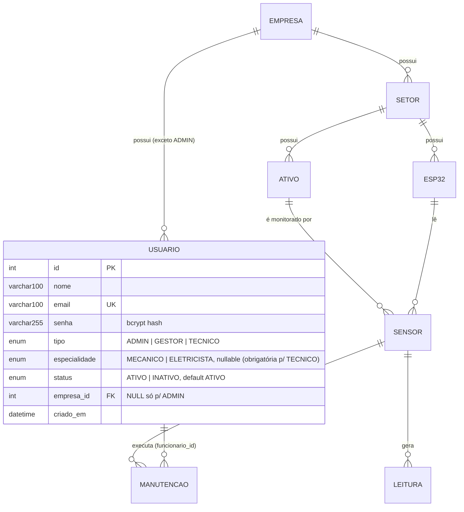

# SIVA Back-End — Relatório Final de Integração para o Front-End

Implementação concluída conforme especificação. Back-end pronto para consumo pelo front-end (repositório separado).

## 0. Como rodar (guia operacional)

```bash
npm install
cp .env.example .env   # ajustar JWT_SECRET, CORS_ORIGIN, DATABASE_URL
# Desenvolvimento com banco:  npm run prisma:deploy && npm run seed && npm run dev
# Desenvolvimento sem banco:  MOCK_MODE=true npm run dev   (ou npm run dev:mock)
```

- **Migration (banco existente):** aplicar `db/migrations/001_roles_status.sql` — converte
  `super_admin→ADMIN`, `admin_empresa→GESTOR`, `funcionario→TECNICO`, cria
  `especialidade` (nullable) e `status` (default `ATIVO`). Banco novo: usar `db/db.sql`.
- **Seed:** `npm run seed` — cria `admin@siva.local` (ADMIN, senha `senha123`, hash bcrypt)
  + empresa/setor/ESP32/ativo/sensor de exemplo + 1 manutenção.
- **URL base (dev):** `http://localhost:3000/api` · **Swagger:** `http://localhost:3000/docs`
  · **Health:** `GET /api/health` (público).
- **Variáveis para integração:** `PORT` · `DATABASE_URL` (ignorado com `MOCK_MODE=true`) ·
  `JWT_SECRET` · `JWT_EXPIRES_IN` (default `8h`) · `CORS_ORIGIN` (ex `http://localhost:5173`) ·
  `MOCK_MODE` · `NODE_ENV` · `RATE_LIMIT_*` · `LOG_LEVEL`.

## 1. O que foi alterado no banco

- `usuario.tipo`: `ENUM('ADMIN','GESTOR','TECNICO')` (era `super_admin/admin_empresa/funcionario`).
- `usuario.especialidade`: `ENUM('MECANICO','ELETRICISTA') NULL` — obrigatória p/ TECNICO.
- `usuario.status`: `ENUM('ATIVO','INATIVO') DEFAULT 'ATIVO'`.
- Arquivos: `prisma/schema.prisma` · `db/db.sql` · `db/migrations/001_roles_status.sql` (nova,
  com mapeamento seguro) · `prisma/seed.ts` (ADMIN `admin@siva.local` + compat `super@siva.com`).

## 1.1. Novo modelo do sistema

```text
ADMIN (global, sem empresa, sem especialidade)
│
EMPRESA
│
├── USUARIOS
│     ├── GESTOR (empresa obrigatória, sem especialidade)
│     └── TECNICO (empresa obrigatória)
│            ├── MECANICO
│            └── ELETRICISTA
│
├── SETORES
│     ├── ATIVOS (tanque, bomba, tubulação)
│     │     └── SENSORES (ligam um ATIVO a um ESP32)
│     │
│     └── ESP32 (espId + token X-Token, um por setor/instalação)
│            └── SENSORES (sensorId lógico, ex "sensor_01")
│                  ├── LEITURAS (vazão L/min, via X-Token)
│                  └── MANUTENCOES (preventiva|corretiva|inspecao → funcionario TECNICO)
```



| Tipo | empresaId | especialidade | status | Escopo |
|---|---|---|---|---|
| `ADMIN` | `null` (proibido enviar) | `null` (proibida) | `ATIVO\|INATIVO` | Global |
| `GESTOR` | obrigatório | `null` (proibida) | `ATIVO\|INATIVO` | Própria empresa |
| `TECNICO` | obrigatório | `MECANICO\|ELETRICISTA` obrigatória | `ATIVO\|INATIVO` | Própria empresa |

Regras de integridade: FK `usuario.empresa_id → empresa.id`; `UNIQUE(email, cnpj, ativo.tag,
esp32.esp_id, esp32.token, sensor.tag, sensor(esp32_id,sensor_id))`; sensor exige
`ativo.setor_id == esp32.setor_id` (422); INATIVO bloqueia `POST /login` (403) e `GET /me`.

## 2. Autenticação

- Mantido JWT. `POST /api/auth/login` recebe `{"email","senha"}`.
- Resposta: `{success:true,data:{token,user:{id,nome,email,tipo,especialidade,empresaId,status,criadoEm}}}` — sem senha.
- **INATIVO não loga:** `403 FORBIDDEN`. `GET /api/auth/me` também barra INATIVO.
- JWT payload: `{id,email,tipo,empresaId}` (+`iat/exp`). Sem senha.

```json
// POST /api/auth/login → 200
{"success":true,"data":{"token":"eyJ...","user":{"id":1,"nome":"Administrador SIVA","email":"admin@siva.local","tipo":"ADMIN","especialidade":null,"empresaId":null,"status":"ATIVO","criadoEm":"..."}}}
```

## 3. Permissões

- `authenticateUser` (Bearer) em todo dashboard; `authorize('ADMIN'|'GESTOR'|...)` por rota;
  `assertSameCompany` (ADMIN bypassa; demais exigem `empresaId` igual).
- **Somente ADMIN:** criar/editar/status/excluir usuários; CRUD empresas (escrita);
  `/:id/details`, `/:id/users`, `/dashboard/admin-summary`.
- **GESTOR:** leitura da própria empresa (companies filtrado, users da própria, setores/ativos/
  devices/sensores escopados, leituras/manutenções); escrita em setores/ativos/devices/sensores
  da própria empresa (preservado). Não cria usuários/empresas, não vê dashboard admin.
- **TECNICO:** leitura escopada + CRUD manutenções; sem escrita em users/companies/infra.
- ESP32 (`X-Token`) só em `POST /api/readings`. JWT nunca serve p/ ingestão e vice-versa.

## 4–6. Tipos, especialidade, status

- `tipo`: `ADMIN` (sem empresa/especialidade) · `GESTOR` (empresa obrigatória, sem especialidade) ·
  `TECNICO` (empresa + `MECANICO|ELETRICISTA` obrigatórias). Validadas no Zod (422) e no service.
- `status`: `ATIVO|INATIVO`. Inativar preserva histórico; INATIVO não loga nem usa rotas protegidas
  (`/me` barra; JWT antigo continua tecnicamente válido até expirar, mas qualquer chamada que
  recarrega o usuário — `/me` — falha; re-login bloqueado).
- Sem `POST /api/auth/register` (não existe cadastro público).

## 7. Endpoints criados

| Método | Endpoint | Auth | Permissão |
|---|---|---|---|
| PATCH | `/api/users/:id/status` `{"status":"ATIVO"\|"INATIVO"}` | JWT | ADMIN |
| GET | `/api/companies/:id/details` | JWT | ADMIN |
| GET | `/api/companies/:id/users` | JWT | ADMIN |
| GET | `/api/dashboard/admin-summary` | JWT | ADMIN |

## 8. Endpoints alterados

- `POST /api/users` — agora só ADMIN; valida combinação tipo/empresa/especialidade; 409 e-mail dup.
- `PATCH /api/users/:id` — só ADMIN; edita nome/email/tipo/empresa/especialidade/senha (senha só se enviada, com hash).
- `DELETE /api/users/:id` — só ADMIN; 409 se houver vínculos (antes podia mascarar como 404/500).
- `GET /api/users` — filtros `?empresaId=&tipo=&status=` combináveis; GESTOR enxerga só a própria; `meta` agora inclui `totalPages`.
- `GET /api/companies` — ADMIN vê todas; demais só a própria (inalterado no comportamento).
- `POST/PATCH/DELETE /api/companies` — `ADMIN` (renomeado de `super_admin`).
- Infra (`sectors/assets/devices/sensors`) escrita — `ADMIN,GESTOR` (renomeado); leitura escopada.
- `POST /api/maintenances` / `PATCH` — valida `funcionarioId`: deve existir, estar ATIVO e ser da mesma empresa do sensor (403/404/422).
- Erros Prisma globalmente mapeados: `P2002→409`, `P2003/P2014→409`, `P2025→404` (antes 500).
- `paginated()` inclui `totalPages` (aditivo, sem quebra).
- Swagger (`/docs`) atualizado: enums novos + 4 novas rotas.

## 9. Removidos/depreciados

- Nomes `super_admin/admin_empresa/funcionario` removidos da API (respostas, validações, authorize).
  Tokens JWT antigos com esses valores passam a receber 403. `isSuperAdmin` mantido como alias
  interno de `isAdmin` (sem efeito na API).

## 10–11. Requests / Responses (+ exemplos reais)

Padrão sucesso: `{success:true,data}` (+`meta{total,page,pageSize,totalPages}` em listas);
`201` criações, `204` sem corpo em deletes. Erro: `{success:false,error:{code,message,details?}}`.

```json
// ADMIN cria GESTOR → POST /api/users → 201
{"nome":"Carlos","email":"carlos@email.com","senha":"senha12345","tipo":"GESTOR","empresaId":1}
// → {"success":true,"data":{"id":9,"nome":"Carlos","email":"carlos@email.com","tipo":"GESTOR","especialidade":null,"status":"ATIVO","empresaId":1,"criadoEm":"..."}}

// ADMIN cria TECNICO → POST /api/users → 201
{"nome":"João","email":"joao@email.com","senha":"senha12345","tipo":"TECNICO","empresaId":1,"especialidade":"MECANICO"}

// ADMIN cria ADMIN → POST /api/users → 201
{"nome":"Novo Admin","email":"admin2@siva.com","senha":"senha12345","tipo":"ADMIN"}

// Editar → PATCH /api/users/9 → 200  {"nome":"Carlos S.","empresaId":1}
// Status → PATCH /api/users/9/status → 200  {"status":"INATIVO"}
// Detalhes → GET /api/companies/1/details → 200
{"success":true,"data":{"empresa":{"id":1,"nome":"...","cnpj":"..."},"funcionarios":[...],"setores":[...],"resumo":{"funcionarios":10,"setores":4,"ativos":6,"esp32":5,"sensores":20}}}
// Dashboard → GET /api/dashboard/admin-summary → 200
{"success":true,"data":{"nEmpresas":2,"nFuncionarios":5,"nSensores":3,"nEsp32":3,"funcionarios":{"total":5,"gestores":2,"tecnicos":2,"mecanicos":1,"eletricistas":1,"ativos":5,"inativos":0}}}
// ESP32 → POST /api/devices {"setorId":1,"espId":"esp_04","descricao":"..."} → 201 (token SÓ aqui)
{"success":true,"data":{"id":4,"setorId":1,"espId":"esp_04","token":"dev-...","descricao":"...","ultimoContato":null,"criadoEm":"..."}}
```

## 12. Autorização (resumo)

ADMIN global; GESTOR/TECNICO restritos à própria empresa em todas as camadas. Front só esconde
menus — a trava real é no back (testes cobrem cross-empresa 403, GESTOR criando usuário 403,
dashboard por GESTOR 403, details de outra empresa 403).

## 13–18. Fluxos

- **Login:** `POST /login {email,senha}` → `{token,user}` → front guarda token, usa
  `Authorization: Bearer`, chama `GET /me`, roteia por `tipo` (`/admin|/gestor|/tecnico`) e
  `especialidade` quando TECNICO. Sem `/register`.
- **Empresa:** `POST /companies {nome,cnpj?}` → `GET /companies` → `GET /:id/details` →
  `GET /:id/users` → `PATCH /companies/:id` / `DELETE` (409 com vínculos).
- **Usuário:** `POST /users` (ADMIN) → `PATCH /users/:id` → `PATCH /:id/status` → `DELETE` (409 com histórico; inativar é o caminho).
- **ESP32:** `POST /devices {setorId,espId,descricao?}` → **copiar `token` da resposta** →
  entregar `espId+token+sensor_id` à empresa → firmware `POST /api/readings` com `X-Token`.
  GET/PATCH nunca retornam token. Sem regeneração nesta etapa.
- **Sensor:** `POST /sensors {ativoId,esp32Id,sensorId,tag?,descricao?,ativoStatus?}` (exige
  `ativo.setor == esp32.setor`, 422); `PATCH` edita `tag/descricao/ativoStatus`; sem token próprio.
- **Infra:** `EMPRESA→SETOR→ATIVO` e `→ESP32→SENSOR` (inalterada).
- **Dashboard ADMIN:** `GET /dashboard/admin-summary` (números reais do banco).
- **Detalhes empresa:** `GET /companies/:id/details` (tela Ver mais) + `GET /:id/users` (aba funcionários).

## 19–21. JWT / X-Token / HTTP / erros

- Front: `Authorization: Bearer <JWT>` em tudo (dashboard). ESP32: `X-Token: <token>` só em
  `POST /api/readings {esp_id,sensor_id,vazao>=0,setor?}`.
- Status: `200 GET/PATCH` · `201 POST` · `204 DELETE` · `400` · `401 sem/inválido` ·
  `403 sem permissão ou INATIVO` · `404` · `409 duplicidade/vínculo` · `422 validação` · `500`.
- Duplicidades (email/CNPJ/tag/espId) → `409 CONFLICT`, nunca 500.

## 22. Tabela final (endpoints REAIS)

| Funcionalidade | Método | Endpoint | Auth | Permissão |
|---|---|---|---|---|
| Login | POST | `/api/auth/login` | Não | Público |
| Me | GET | `/api/auth/me` | JWT | Autenticado ATIVO |
| Dashboard | GET | `/api/dashboard/admin-summary` | JWT | ADMIN |
| Empresas | GET | `/api/companies` | JWT | ADMIN todas; demais a própria |
| Criar empresa | POST | `/api/companies` | JWT | ADMIN |
| Detalhe empresa | GET | `/api/companies/:id` | JWT | Escopo empresa |
| Detalhes empresa | GET | `/api/companies/:id/details` | JWT | ADMIN |
| Funcionários empresa | GET | `/api/companies/:id/users` | JWT | ADMIN |
| Editar empresa | PATCH | `/api/companies/:id` | JWT | ADMIN |
| Excluir empresa | DELETE | `/api/companies/:id` | JWT | ADMIN (409 c/ vínculos) |
| Listar usuários | GET | `/api/users?empresaId=&tipo=&status=` | JWT | ADMIN global; GESTOR própria |
| Criar usuário | POST | `/api/users` | JWT | ADMIN |
| Editar usuário | PATCH | `/api/users/:id` | JWT | ADMIN |
| Status usuário | PATCH | `/api/users/:id/status` | JWT | ADMIN |
| Excluir usuário | DELETE | `/api/users/:id` | JWT | ADMIN (409 c/ histórico) |
| Setores | GET/POST/PATCH/DELETE | `/api/sectors[/:id]` | JWT | Leitura escopada; escrita ADMIN,GESTOR |
| Ativos | GET/POST/PATCH/DELETE | `/api/assets[/:id]` | JWT | Leitura escopada (`?setorId=` obr.); escrita ADMIN,GESTOR |
| Criar ESP32 | POST | `/api/devices` | JWT | ADMIN,GESTOR (token só aqui) |
| Listar/ver ESP32 | GET | `/api/devices[/:id]` | JWT | Escopo (sem token) |
| Criar sensor | POST | `/api/sensors` | JWT | ADMIN,GESTOR |
| Listar/editar sensor | GET/PATCH/DELETE | `/api/sensors[/:id]` | JWT | Escopo; escrita ADMIN,GESTOR |
| Leituras ESP32 | POST | `/api/readings` | X-Token | ESP32 |
| Leituras dashboard | GET | `/api/readings?sensorId=` | JWT | Escopo |
| Manutenções | GET/POST/PATCH/DELETE | `/api/maintenances[/:id]` | JWT | Escopo + funcionario validado |
| Alertas | GET | `/api/alerts` | JWT | 501 (não implementado — "em breve") |
| Health | GET | `/api/health` | Não | Público |

## Não implementado (com motivo)

- Regeneração de token ESP32: não exigida; fluxo atual (token único na criação) preservado.
- Recuperação de senha/MFA/refresh: fora do escopo; troca via `PATCH /users/:id {senha}` (ADMIN).
- Alertas: mantido 501 documentado, sem resposta falsa.
- Desvio consciente da tabela-exemplo: escrita de infra (setores/ativos/devices/sensores)
  permite `ADMIN,GESTOR` (não só ADMIN) — preserva comportamento existente e a autonomia do
  GESTOR sobre a própria empresa (§37: não quebrar o que funciona).

## Validação

`typecheck` OK · `lint` 0 erros · `build` OK · **39/39 testes** (`tests/users-roles.test.ts`
27 novos cobrindo §36 + 12 existentes preservados).
